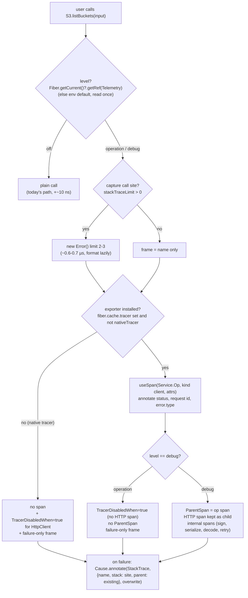

# C. Effect v4 tracing, stack traces and observability — research for distilled

Date: 2026-10-24. Effect version read and measured: **effect 4.0.5** (the repo's `node_modules/effect -> .pnpm/effect@4.0.5`). npm `latest` is 4.0.6; I diffed the tracing code paths I rely on (`makeSpanUnsafe`, the `HttpClient.make` tracing block, `Effect.fn`) against `Effect-TS/effect@main` and they are unchanged.

Path shorthand used below:

- `E/` = `<repo>/node_modules/effect/src/` (effect 4.0.5 source).
- `R/` = `<repo>/` (distilled, read-only).
- All scripts and raw outputs are in `/tmp/otel-research/` (`bench.ts`, `bench-http.ts`, `bench-design.ts`, `bench-design2.ts`, `bench-stack.ts`, `bench-stack2.ts`, `bench-metric.ts`, `first-call*.ts`, `stack-demo.ts`, `stack-demo2.ts`, `log-demo.ts`, `distilled-demo*.ts`, `*-out.md`).

Important v4 fact: in effect 4.0.x stable, the modules are **`effect/http/*`**, **`effect/observability/*`**, **`effect/devtools`**, `effect/sql`, `effect/rpc`, `effect/ai` — not `effect/unstable/...` (that was the rc layout; many web pages and AI-search summaries still say `unstable`). Docs: <https://effect.website/docs/v4/api/effect/observability/OtlpTracer> links source at `packages/effect/src/observability/OtlpTracer.ts`.

Machine: Node v24.19.0, Linux, 16 cores, load average about 3.7 during runs. Numbers are medians of 7 rounds after 2 warm-up rounds. Expect a few percent noise.

---

## 0. Answers in one table

| Question | Answer (effect 4.0.5) |
|---|---|
| Cost of one span, native tracer (no exporter) | `useSpan`: **~360–420 ns**. `withSpan` with default stack capture: **~2.3 µs**. `withSpan` with `captureStackTrace: false`: **~0.9 µs**. |
| Cost with `TracerEnabled = false` | Span becomes a no-op span, but stack capture still runs. `withSpan` default: 2.07 µs. `withSpan` no stack: 0.72 µs. `useSpan`: 0.20 µs. |
| What dominates span cost | 1) `new Error()` for the call site, ~0.6–1.1 µs. 2) Providing `ParentSpan` + `CurrentStackFrame`: both are "fiber-cached" keys, so each one rebuilds the fiber cache, ~0.25 µs each. 3) The span itself (bigint clock ×2, Map, `onExit`), ~0.35 µs. |
| HttpClient span per request | **~3.0 µs** per request, plus `traceparent` + `b3` headers. Turn it off with `HttpClient.TracerDisabledWhen` (or `Tracer.DisablePropagation`). `TracerEnabled=false` does **not** turn it off and sends the invalid header `traceparent: 00-0000…noop-noop-00`. |
| Cold first span in a process | **~0.65 ms** (`useSpan`) to **~0.96 ms** (`Effect.fn`), vs 16 µs for `Effect.succeed`. This is a one-time JIT and lazy-compile cost. |
| Cheapest "is anyone exporting?" check | `fiber.cache.tracer === undefined \|\| === Tracer.nativeTracer` (3 ns). Effect's own HTTP server middleware uses the same check. |
| How a library should depend on OTel | It doesn't. It uses only `effect` spans, logs and metrics. The app provides `effect/observability` `Otlp*` layers, `@effect/opentelemetry` `NodeSdk`, or `effect/devtools`. |
| Debug-level spans in Effect | `Tracer.CurrentTraceLevel` (default `"Info"`) + `Tracer.MinimumTraceLevel` (default `"All"`) + span option `level`. Spans below the minimum are **created, then unsampled**. The cost is still paid, and children inherit `sampled=false`. |

---

## 1. Effect v4 tracing API

### 1.1 Tracer module — `E/Tracer.ts`

| API | Where | Notes |
|---|---|---|
| `interface Tracer { span(options), context? }` | `E/Tracer.ts:31` | `span` gets `{name, parent: Option<AnySpan>, annotations, links, startTime: bigint, kind, root, sampled}`. `context` is an optional hook that wraps evaluation of every primitive (OTel uses it to set the active OTel context). |
| `Tracer.make(impl)` | `E/Tracer.ts:470` | Identity function. |
| `Span` / `ExternalSpan` / `AnySpan` | `E/Tracer.ts:385`, `:207`, `:130` | `Span` has `attribute`, `event`, `addLinks`, `end(endTime, exit)`. `ExternalSpan` is ids only (for parents from headers or other systems). |
| `Tracer.externalSpan({spanId, traceId, sampled?})` | `E/Tracer.ts:512` | Builds a parent from foreign ids. |
| `NativeSpan` | `E/Tracer.ts:695` | Default in-memory span. Ids, attribute Map and events are **lazy**, so an unread native span never generates hex ids. |
| `Tracer.Tracer` reference | `E/Tracer.ts:653` | `Context.Reference`, `fiberCached: true`, default `nativeTracer`. |
| `Tracer.nativeTracer` | `E/Tracer.ts:672` | Docs: "Runtime code can compare the active tracer against `nativeTracer` to detect that no tracing backend is installed and skip work". Used by `E/http/HttpEffect.ts:190`, `E/http/HttpMiddleware.ts:269`, `E/http/HttpRouter.ts:240`. |
| `Tracer.ParentSpan` | `E/Tracer.ts:178` | `Context.Service` with `fiberCached: true`. |
| `Tracer.DisablePropagation` | `E/Tracer.ts:557` | `Reference<boolean>`. When true, new spans are no-op spans and are skipped as parents. Not fiber-cached, so it is cheap to provide (measured ~105 ns). |
| `Tracer.CurrentTraceLevel` | `E/Tracer.ts:581` | Default `"Info"`. This is the span level when the `level` option is absent. |
| `Tracer.MinimumTraceLevel` | `E/Tracer.ts:611` | Default `"All"`. A span below this level gets `sampled=false`. An explicit `sampled` option bypasses it. |
| `SpanOptions` = `SpanOptionsNoTrace & TraceOptions` | `E/Tracer.ts:255-287` | `attributes, links, parent, root, annotations, kind, sampled, level` + `captureStackTrace?: boolean \| LazyArg<string \| undefined>`. |

### 1.2 References — `E/References.ts`, `E/internal/references.ts`

| Reference | Default | Fiber-cached? (changing it rebuilds the fiber cache) |
|---|---|---|
| `TracerEnabled` (`:404`) | `true` | yes |
| `TracerTimingEnabled` (`:563`) | `true` | no |
| `TracerSpanAnnotations` (`:459`) | `{}` | no |
| `TracerSpanLinks` (`:519`) | `[]` | no |
| `CurrentStackFrame` (`:324`) | `undefined` | yes |
| `CurrentLogLevel` (`:234`) | `"Info"` | yes |
| `MinimumLogLevel` (`:361`) | `"Info"` | yes |
| `CurrentLogAnnotations`, `CurrentLogSpans`, `CurrentLoggers` | — | no |

"Fiber-cached" means this. The fiber keeps a `cache` object computed from the context (`E/internal/effect.ts:745-762`: scheduler, tracer, tracerEnabled, span, logLevel, minimumLogLevel, stackFrame, …). Providing a fiber-cached key creates a new `cacheRoot` (`E/Context.ts:1034`), so the cache is rebuilt. `fiberCached` is `@internal`, so distilled's own references can't opt in. Reading a non-cached reference with `fiber.getRef` costs about 20 ns (measured).

`Fiber.Cache` is **public** in the type (`E/Fiber.ts:173-185`): `fiber.cache.tracer`, `fiber.cache.tracerEnabled`, `fiber.cache.span`, `fiber.cache.stackFrame` are plain field reads. Note: `fiber.cache.tracer` holds only an *explicit* tracer override. It is `undefined` when the native tracer is in use (`E/internal/effect.ts:6018`).

### 1.3 Span combinators — `E/internal/effect.ts`

| API | Line | What it does |
|---|---|---|
| `makeSpanUnsafe(fiber, name, options)` | 5992 | The core. If `!fiber.cache.tracerEnabled` (or `DisablePropagation` is in the annotations), it returns a `noopSpan` (ids `"noop"`, `sampled:false`). Otherwise it calls `tracer.span(...)` with `startTime = clock.currentTimeNanosUnsafe()` (or `0n` if timing is off). It computes `sampled` from the parent and `MinimumTraceLevel`, then copies `TracerSpanAnnotations` and `options.attributes` into the span. |
| `Effect.useSpan(name, options?, f)` | 6161 | `makeSpanUnsafe` + `onExitUnsafe(end span)`. **Does not** set `ParentSpan` and **does not** capture a stack. This is the cheapest public span. |
| `Effect.makeSpan` / `makeSpanScoped` | 6060 / 6066 | The span is ended by you, or by the scope finalizer. |
| `Effect.withParentSpan(self, span, traceOptions?)` | 6189 | Provides `ParentSpan`. For an Effect `Span` it **also** calls `addSpanStackTrace` and provides `CurrentStackFrame`. That is 2 fiber-cached keys, so 2 cache rebuilds. |
| `Effect.withSpan(self, name, options)` / `withSpan(name, options, traceOptions)` | 6215 | `useSpan` + `withParentSpan`. **`addSpanStackTrace` runs when `withSpan(...)` is called**: data-first, once per call. Pipeable form: once, when the pipeable is created. |
| `Effect.withSpanScoped` | 6084 | Scoped variant. |
| `Effect.annotateCurrentSpan(k, v)` | 6268 | Writes to `fiber.currentSpanLocal`. Measured ~83 ns (including the flatMap). |
| `Effect.annotateSpans(...)` | 6245 | Updates `TracerSpanAnnotations` for every span created inside. |
| `Effect.linkSpans(span(s), attrs)` | 6128 | Appends to `TracerSpanLinks`. |
| `Effect.withTracerEnabled(bool)` | 5944 | `provideService(TracerEnabled)`. |
| `Effect.withTracerTiming(bool)` | 5950 | `provideService(TracerTimingEnabled)`. |
| `Effect.currentSpan` / `currentParentSpan` | 6287 / 6293 | |
| `Layer.span(name, opts)` | `E/Layer.ts:4471` | A scoped span that becomes `ParentSpan` for the layers built under it. Also captures a stack. |
| `Layer.parentSpan(span)` | `E/Layer.ts:4530` | Provides an existing span as parent. |
| `Layer.withSpan(name, opts)` | `E/Layer.ts:4594` | Wraps layer construction in a span. |

`addSpanStackTrace` (`E/internal/tracer.ts`) works like this:

1. If `captureStackTrace === false`, or it is a function, or `Error.stackTraceLimit === 0` (unless `captureStackTrace: true`), it returns with no capture.
2. Otherwise it sets `Error.stackTraceLimit = 3`, runs `new Error()`, and restores the limit.
3. It returns a lazy cleaner that formats `.stack` and keeps line index 3. That is the **immediate caller of `withSpan`**, which for a library is library code. See the demo in §2.

### 1.4 `Effect.fn` vs `fnUntraced` — `E/internal/effect.ts:1248-1351`

- `Effect.fn("name")(body, ...pipeables)`:
  - **At definition**, when `stackTraceLimit !== 0`: one `new Error()` with limit 2.
  - **On every call**: another `new Error()` with limit 2, plus `useSpan(name, spanOptions)` + `provideParentSpan`, plus `updateService(CurrentStackFrame, …)` with two frames (`name` → call site, and `name (definition)` → definition site).
- `Effect.fn(body)` **with no name**: no span, but **still captures both stacks and provides `CurrentStackFrame`**. It is not free: measured 1.41 µs/call.
- `Effect.fnUntraced(body, ...pipeables)`: a plain `suspend(() => fromIteratorUnsafe(body.apply(this, arguments)))`. Measured ~61 ns over `Effect.succeed`. `fnUntracedEager` runs synchronous prefixes eagerly.
- Issue [#8038](https://github.com/Effect-TS/effect/issues/8038) ("Effect.fn constructs an Error at every definition site, which costs most of a Cloudflare Workers startup budget"): in workerd each `new Error()` cost **19–256 µs**, depending on the size of the module it sits in. It was closed by PR [#8114](https://github.com/Effect-TS/effect/pull/8114): "Skip optional stack capture when stackTraceLimit is zero". So in v4, **`Error.stackTraceLimit = 0` is the official switch for "no optional stack capture"**. Named spans and frames remain; only locations are dropped. distilled should follow the same rule.

### 1.5 Measured cost of span primitives (`/tmp/otel-research/bench.ts`, N=200 000)

Each iteration builds a fresh effect (like a per-call SDK wrapper) and chains it in one fiber.

```
effect 4.0.5, node v24.19.0, N=200000, rounds=7 (median)
| variant | ns/op | ops/sec | added ns vs baseline |
|---|---:|---:|---:|
| baseline Effect.succeed | 35 | 28,807,232 | 0 |
| Effect.withFiber + getRef (1 ref check) | 56 | 17,895,093 | 21 |
| withSpan data-first (stack captured per call) | 2334 | 428,387 | 2300 |
| withSpan data-first captureStackTrace:false | 904 | 1,106,106 | 869 |
| withSpan data-first + 3 attributes | 2430 | 411,516 | 2395 |
| withSpan pipeable reused (stack once) | 963 | 1,038,667 | 928 |
| withSpan pipeable reused, no stack | 1028 | 972,595 | 993 |
| withSpan data-first, TracerEnabled=false | 2103 | 475,450 | 2069 |
| withSpan no stack, TracerEnabled=false | 757 | 1,320,764 | 722 |
| withSpan data-first, Error.stackTraceLimit=0 | 949 | 1,053,630 | 914 |
| withSpan data-first, recording tracer | 2589 | 386,251 | 2554 |
| withSpan no stack + attrs, recording tracer | 1243 | 804,460 | 1208 |
| Effect.fn('op') traced | 2273 | 439,894 | 2239 |
| Effect.fn('op') traced, TracerEnabled=false | 2038 | 490,759 | 2003 |
| Effect.fn('op') traced, recording tracer | 2492 | 401,224 | 2458 |
| Effect.fn(unnamed) (stack frames, no span) | 1446 | 691,737 | 1411 |
| Effect.fnUntraced | 96 | 10,448,709 | 61 |
| Effect.fn('op') traced, stackTraceLimit=0 | 1016 | 984,521 | 981 |
| succeed + annotateCurrentSpan (no span) | 118 | 8,471,690 | 83 |
| succeed + logDebug (below min level) | 134 | 7,436,946 | 100 |
| succeed + Metric.update counter | 142 | 7,049,341 | 107 |
| useSpan no stack (makeSpanUnsafe directly) | 396 | 2,528,364 | 361 |
```

"Recording tracer" = `Tracer.make` that builds a `NativeSpan`, reads its ids and pushes it to an array. It approximates an exporter's per-span cost without I/O. PR [#7918](https://github.com/Effect-TS/effect/pull/7918) measured the real `OtlpTracer` at ~231 ns per unsampled span and ~82 µs per sampled 100-span JSON export batch.

Raw V8 call-site capture (`bench-stack.ts`, `bench-stack2.ts`, outside Effect):

```
| new Error() (default stackTraceLimit=10) | 1092 |
| set limit 3 + new Error() + restore (Effect's addSpanStackTrace) | 783 |
| Error.captureStackTrace(obj) limit 3 | 906 |
| new Error() + read .stack (format) | 2368 |
| Error.stackTraceLimit = 0 then new Error() | 92 |
| new Error(), stackTraceLimit=1 | 565 |
| new Error(), stackTraceLimit=2 | 622 |
| new Error(), stackTraceLimit=3 | 701 |
| new Error(), stackTraceLimit=6 | 1076 |
| Fiber.getCurrent() (inside a running fiber) | 5 |
| Fiber.getCurrent()?.getRef(Level) | 9 |
| Fiber.getCurrent()?.cache.tracer === undefined | 3 |
```

V8 collects frames when the error is constructed and formats them only when `.stack` is read. Formatting costs another ~1.6 µs, but only on failure. There is no cheaper V8 API for a call site.

Cold first call in a fresh process (`first-call.ts`, median of 7 processes, after one warm `Effect.runSync(Effect.succeed(0))`):

```
succeed: 16 µs
useSpan: 651 µs
withSpanNoStack: 782 µs
withSpan: 834 µs
fn: 959 µs
(break-down: onExit alone ~370 µs, NativeSpan ctor ~26 µs, hrtime ~3 µs — it is first-execution compile cost of the span/onExit code paths)
```

So the first span in a process adds ~0.6–1 ms to "first call" (benches track first call at ~4 ms). This matches the prior finding of ~0.9 ms for HttpClient's first-call span.

### 1.6 How to turn tracing off cheaply

| Switch | What it skips | What it does not skip |
|---|---|---|
| `Error.stackTraceLimit = 0` | All optional `new Error()` captures in `withSpan` / `Effect.fn` / `Layer.span` (PR #8114). | Spans. |
| `TracerEnabled = false` | `tracer.span` (no-op span instead), attributes, clock reads. | Stack capture (it happens before the fiber runs); `ParentSpan` / `CurrentStackFrame` provisioning; **the HttpClient span block** (see §3). |
| `DisablePropagation = true` | Spans made inside become no-op; HttpClient makes no span and sends no headers. | Same as above for stack capture. It also hides spans of anything nested, for example a credential provider calling STS. |
| `MinimumTraceLevel` | Nothing at creation: spans are still created and only marked `sampled=false`, so the exporter drops them. | All cost. |
| A library's own check `fiber.cache.tracer === undefined \|\| === nativeTracer` | Everything, when no backend is installed (~30 ns with a level check, measured). | — |

---

## 2. Stack traces in Effect v4

### 2.1 Mechanism

1. Each `Effect.fn` call or `withSpan` / `withParentSpan` pushes a `StackFrame {name, stack: () => string | undefined, parent}` onto `References.CurrentStackFrame`. This is a linked list; see `E/References.ts:611`.
2. When a failure is created, `exitFailCause` annotates the cause with `Cause.StackTrace = fiber.cache.stackFrame` (`E/internal/core.ts:600-608`). Existing annotations are kept: the **innermost frame wins**.
3. `Cause.pretty` / `Cause.prettyErrors` (`E/internal/effect.ts:274`, `causePrettyError` at 315) take the error's own `.stack`. `cleanErrorStack` (`:374`) cuts it at the first `Generator.next` / `~effect/` frame. Then `addStackAnnotations` → `currentStackTrace(frame)` (`:391`, `:410`) appends `    at <frame.name> (<location>)` for up to **10** frames, following `parent`.
4. In v4 the span stack is **not** exported as a `code.stacktrace` attribute (I found no `code.*` attribute anywhere in effect 4.0.5). It reaches a backend only through the failure path: `OtlpTracer` adds an `exception` event with `exception.stacktrace = Cause.prettyErrors(cause, {includeCauseInStack:true})[i].stack` (`E/observability/OtlpTracer.ts:334-366`).
5. `Error.stackTraceLimit` interactions:
   - `0` disables all optional captures. Frames still print names without locations.
   - The error's own stack (for example `Data.TaggedError`) also has no lines at limit 0.
   - `currentStackTrace` prints at most 10 frames, whatever the limit.

### 2.2 Demo output (`node /tmp/otel-research/stack-demo.ts`, pasted verbatim)

Source shapes:

1. `Effect.fn("S3.listObjectsV2") → Effect.fn("http.send") → Effect.fn("protocol.decode")` yields a `Data.TaggedError` or a `Schema.TaggedError`.
2. Plain combinators.
3. Plain combinators + one `withSpan`.
4. `withSpan` whose `captureStackTrace` is a lazy call-site string captured by the library.

```
===== 1. nested Effect.fn traced, Data.TaggedError =====
--- Cause.pretty:
ThrottlingException: Rate exceeded
    at file:///tmp/otel-research/stack-demo.ts:13:37
    at protocol.decode (file:///tmp/otel-research/stack-demo.ts:17:17)
    at protocol.decode (definition) (file:///tmp/otel-research/stack-demo.ts:12:23)
    at http.send (file:///tmp/otel-research/stack-demo.ts:20:17)
    at http.send (definition) (file:///tmp/otel-research/stack-demo.ts:16:21)
    at S3.listObjectsV2 (file:///tmp/otel-research/stack-demo.ts:62:54)
    at S3.listObjectsV2 (definition) (file:///tmp/otel-research/stack-demo.ts:19:28)
--- prettyErrors[0].name/message: ThrottlingException / Rate exceeded
--- raw error.stack (first 4 lines):
ThrottlingException: Rate exceeded
    at file:///tmp/otel-research/stack-demo.ts:13:37
    at Generator.next (<anonymous>)
    at ~effect/Effect/successCont (file://<repo>/node_modules/.pnpm/effect@4.0.5/node_modules/effect/dist/internal/effect.js:979:28)

===== 2. nested Effect.fn traced, Schema.TaggedError =====
--- Cause.pretty:
NoSuchBucket: The specified bucket does not exist
    at file:///tmp/otel-research/stack-demo.ts:14:17
    at protocol.decode (file:///tmp/otel-research/stack-demo.ts:17:17)
    at protocol.decode (definition) (file:///tmp/otel-research/stack-demo.ts:12:23)
    at http.send (file:///tmp/otel-research/stack-demo.ts:20:17)
    at http.send (definition) (file:///tmp/otel-research/stack-demo.ts:16:21)
    at S3.listObjectsV2 (file:///tmp/otel-research/stack-demo.ts:63:56)
    at S3.listObjectsV2 (definition) (file:///tmp/otel-research/stack-demo.ts:19:28)

===== 3. plain combinators (no fn/withSpan) =====
NoSuchBucket: The specified bucket does not exist
    at plainDecode (file:///tmp/otel-research/stack-demo.ts:27:19)
    at file:///tmp/otel-research/stack-demo.ts:28:82

===== 4. one withSpan per operation (default stack capture) =====
NoSuchBucket: The specified bucket does not exist
    at plainDecode (file:///tmp/otel-research/stack-demo.ts:27:19)
    at file:///tmp/otel-research/stack-demo.ts:28:82
    at S3.listObjectsV2 (file:///tmp/otel-research/stack-demo.ts:32:10)      <- the LIBRARY line that called withSpan

===== 5. withSpan with library-captured user call site =====
NoSuchBucket: The specified bucket does not exist
    at plainDecode (file:///tmp/otel-research/stack-demo.ts:27:19)
    at file:///tmp/otel-research/stack-demo.ts:28:82
    at S3.listObjectsV2 (file:///tmp/otel-research/stack-demo.ts:66:58)      <- the USER line

===== spans recorded for shape 1 =====
S3.listObjectsV2  parent=-  status=Ended/Failure  attrs=[]
http.send  parent=S3.listObjectsV2  status=Ended/Failure  attrs=[]
protocol.decode  parent=http.send  status=Ended/Failure  attrs=[]

===== 6. Error.stackTraceLimit = 0 (set before Effect.fn definition) =====
ThrottlingException: Rate exceeded
    at protocol.decode
    at protocol.decode (definition) (file:///tmp/otel-research/stack-demo.ts:12:23)
    at http.send
    at http.send (definition) (file:///tmp/otel-research/stack-demo.ts:16:21)
    at S3.listObjectsV2
    at S3.listObjectsV2 (definition)
```

(In case 6 the two inner definitions were created before the limit changed, so they keep their definition lines.)

Takeaways:

- `Data.TaggedError` and `Schema.TaggedError` behave the same. Both capture their own stack at construction; `Cause.pretty` keeps the frames above the first Effect-internal frame.
- A library `withSpan` with default capture points at the library, not at the user (case 4). To show the user's line, the library must capture the frame itself, at the moment the user calls the SDK function, and pass it as a lazy `captureStackTrace` (case 5).

### 2.3 distilled today vs the user's goal (`distilled-demo-head.ts`, committed HEAD `26512492a`)

I copied HEAD with `git archive` to `/tmp/otel-research/head`, so the worktree was not touched. The test runs S3 `listBuckets` against a mocked 403 `AccessDenied`, with a recording tracer:

```
--- Cause.pretty (distilled today):
AccessDeniedException: Access Denied
    at Object.<anonymous> (/tmp/otel-research/head/packages/aws/src/client/response-parser.ts:359:19)

--- spans recorded (distilled today):
GET kind=client parent=- attrs={"http.request.method":"GET","url.full":"https://s3.us-east-1.amazonaws.com/?x-id=ListBuckets","url.path":"/","url.query":"x-id=ListBuckets","url.scheme":"https","server.address":"s3.us-east-1.amazonaws.com","server.port":443,"http.response.status_code":403,"error.type":"403"}

--- trace headers sent: {"traceparent":"00-76badfa121b838a5fa4d075ac666383b-40c056f9cd3bda97-01","b3":"76badfa121b838a5fa4d075ac666383b-40c056f9cd3bda97-1"}
```

So today there is no operation span, no user call site, and the only span is Effect's `GET` (with propagation headers sent to AWS).

Note: the shared worktree contains **another agent's uncommitted prototype** (`R/packages/core/src/telemetry.ts`, plus edits in `api.ts`, `aws/src/protocol.ts`, `cloudflare/src/protocol.ts`; marked "BRAINSTORM PROTOTYPE"). Running the same demo against it gives `S3.ListBuckets kind=client` (rpc.* attrs, error.type) → child `GET`, and `at S3.ListBuckets (/tmp/otel-research/distilled-demo.ts:32:20)` (the user's line). I did not change it. Comments on it against these findings are in §8.4.

### 2.4 Failure-only call-site frame (`stack-demo2.ts`) — no context change on success

`Cause.annotate(cause, Context.make(Cause.StackTrace, frame), { overwrite: true })` in a `catchCause` adds the operation frame only when the call fails:

```
AccessDenied: Access Denied
    at file:///tmp/otel-research/stack-demo2.ts:15:81
    at S3.ListBuckets (file:///tmp/otel-research/stack-demo2.ts:41:17)     <- user's `yield* operation(...)` line
    at handleRequest (file:///tmp/otel-research/stack-demo2.ts:44:33)      <- user's own Effect.fn frames kept
    at handleRequest (definition) (file:///tmp/otel-research/stack-demo2.ts:40:28)
```

`overwrite: true` is required. Without it, the frame that `exitFailCause` attached at the failure point (the user's `handleRequest`) wins, and the SDK frame is lost. I tried that first: it printed only the `handleRequest` frames. Set `parent` to the frame the cause already carries. Success-path cost of the `catchCause` wrapper: ~10 ns (variant I in §8.3).

---

## 3. `effect/http` HttpClient tracing — `E/http/HttpClient.ts`

Code: `HttpClient.make` at `:858`, tracing block at `:883-940`.

1. `tracerDisabled = fiber.getRef(Tracer.DisablePropagation) || fiber.getRef(TracerDisabledWhen)(request)`. If true, there is no span and no headers.
2. Otherwise: `Effect.useSpan(SpanNameGenerator(request), { kind: "client" }, span => …)`.
   - Attributes: `http.request.method`, `url.full` (with redacted query params), `url.path`, `url.query`, `url.scheme`, `server.address`, `server.port` (`E/http/internal/tracing.ts:23-34`), plus opt-in header attributes (`TracerHeaderFilter`, default none).
   - After the response: `http.response.status_code`. For 4xx/5xx it adds `error.type = "<status>"` and ends the span with a failure exit.
   - If `TracerPropagationEnabled` (default `true`): `HttpClientRequest.setHeaders(request, HttpTraceContext.toHeaders(span))`. That writes `b3: <trace>-<span>-<1|0>[-<parent>]` and `traceparent: 00-<trace32>-<span>-<01|00>` (`E/http/HttpTraceContext.ts`).
   - The runner runs under `Effect.withParentSpan(span, { captureStackTrace: false })`.
3. **Span name** in 4.0.5 is `request.method` (for example `GET`), from `SpanNameGenerator` (`:2294`). It is not `http.client GET`, which was the v3 name.
4. In 4.0.5 the knobs are **References** (provide them with `Effect.provideService` or `Layer.succeed`):
   - `HttpClient.TracerDisabledWhen: Reference<Predicate<HttpClientRequest>>` (`:2236`, default `constFalse`)
   - `HttpClient.TracerPropagationEnabled: Reference<boolean>` (`:2279`, default `true`)
   - `HttpClient.SpanNameGenerator` (`:2294`), `HttpClient.TracerHeaderFilter`
   - There are **no** `withTracerDisabledWhen` / `withTracerPropagation` combinators in 4.0.5. Those were the v3 names.
5. Parenting: the HTTP span's parent is `fiber.cache.span`, the current `ParentSpan`. To make it a child of a library's operation span, provide `Tracer.ParentSpan` = op span around `client.execute`.

Measured (`bench-http.ts`, mock runner returning a canned `Response`, N=50 000):

```
| variant | µs/request | added µs vs DisablePropagation |
|---|---:|---:|
| default (http span + propagation headers) | 4.28 | 3.07 |
| Tracer.DisablePropagation=true (no http span) | 1.21 | 0.00 |
| HttpClient.TracerDisabledWhen(() => true) | 1.35 | 0.14 |
| HttpClient.TracerPropagationEnabled=false (span kept, no headers) | 4.08 | 2.87 |
| TracerEnabled=false | 3.93 | 2.72 |
| op span (no stack) + http span | 5.59 | 4.38 |
| op span (no stack) + http span disabled inside | 2.82 | 1.61 |
| recording tracer, default | 4.53 | 3.32 |
| recording tracer, op span + http span | 6.14 | 4.93 |
```

**Bug-ish finding** (`headers-tracer-off.ts`). `TracerEnabled=false` does not take the `tracerDisabled` branch. The client gets a no-op span and still injects its ids:

```
TracerEnabled=false headers: {"b3":"noop-noop-0","traceparent":"00-0000000000000000000000000000noop-noop-00"}
default headers: {"b3":"3612f588…-bb2ace95…-1","traceparent":"00-3612f588…-bb2ace95…-01"}
```

The same code is on `main`. I found no GitHub issue for it (I searched `TracerEnabled traceparent`, `noop traceparent`). A library that disables tracing must set `TracerDisabledWhen` or `DisablePropagation`, not only `TracerEnabled`.

**Recommended library pattern:**

- Default: create the logical-operation span and annotate it with the HTTP facts (`http.response.status_code`, `server.address`, `url.full` without secrets). Suppress the Effect HTTP span with `HttpClient.TracerDisabledWhen = constTrue`. This is a non-fiber-cached key, so it costs ~105 ns, and it removes ~3 µs of HTTP span cost. It also stops `traceparent` / `b3` headers going to cloud APIs; AWS ignores them, since X-Ray uses `X-Amzn-Trace-Id`. Prefer `TracerDisabledWhen` over `DisablePropagation`: `DisablePropagation` also turns every nested span into a no-op, for example a credential provider's own distilled STS call.
- Debug: provide `ParentSpan = opSpan` and leave the HTTP span on, so it nests under the operation.
- Caveat: providing `TracerDisabledWhen` inside the operation replaces any predicate the user set. It cannot be composed cheaply; read the outer one with `getRef` and OR it in if that matters.
- With `@effect/opentelemetry` + Node auto-instrumentation (undici/fetch), a third span (the undici span) can appear under whichever span is active in the OTel context. UNCLEAR: I did not test this.

---

## 4. OTel integration paths (the app's choice, not the library's)

| Path | Modules | Deps | Notes |
|---|---|---|---|
| Built-in OTLP | `effect/observability`: `Otlp` (`layer`, `layerJson`, `layerProtobuf`, `layerFromConfig`), `OtlpTracer`, `OtlpLogger`, `OtlpMetrics`, `OtlpExporter`, `OtlpSerialization` (`layerJson`/`layerProtobuf`), `OtlpResource`, `PrometheusMetrics` (`E/observability/*.ts`) | none beyond `effect` + an `HttpClient` | `OtlpTracer.make({url, resource, headers, compression, exportInterval=5s, maxBatchSize=1000, shutdownTimeout=3s, context?})` (`OtlpTracer.ts:49`). It exports only **sampled** spans (`:103`). `layerFromConfig` reads `OTEL_SDK_DISABLED`, `OTEL_EXPORTER_OTLP_*`, `OTEL_BSP_*`, `OTEL_SERVICE_NAME`, `OTEL_RESOURCE_ATTRIBUTES` (`OtlpTracer.ts:166-205`, `OtlpResource.ts:86-111`). Docs: <https://effect.website/docs/v4/api/effect/observability/OtlpTracer>, <https://effect.website/docs/v4/api/effect/observability/Otlp>. |
| OTel JS SDK | `@effect/opentelemetry` 4.0.6: `NodeSdk` (`layer`, `layerEmpty`, `layerTracerProvider`), `WebSdk`, `OtelTracer`, `OtelMetrics`, `OtelLogger`, `Resource` (<https://github.com/Effect-TS/effect/tree/main/packages/opentelemetry/src>) | peers: `@opentelemetry/api` 1.9+, `sdk-trace-base/node/web` 2.x, `sdk-metrics` 2.x, `sdk-logs` ≥0.203, `resources` 2.x, `semantic-conventions` ≥1.33 (npm registry) | `NodeSdk.layer(() => ({ resource, spanProcessor, metricReader, logRecordProcessor, … }))`. A signal is on only if its processor or reader is supplied (<https://effect.website/docs/v4/api/opentelemetry/NodeSdk>). Use it when auto-instrumentations or other OTel-native libraries must share the context. |
| DevTools | `effect/devtools`: `DevTools.layer(url = "ws://localhost:34437")`, `layerWebSocket`, `layerSocket` (`E/devtools/DevTools.ts:24-69`) | `effect` only | Installs a tracer that mirrors the current one and streams spans, events and metric snapshots. |

**How the library stays exporter-free:**

- distilled imports only `effect/Tracer`, `effect/Effect`, `effect/Context`, `effect/Metric` and `effect/Logger` concepts. It never imports `effect/observability`, `@effect/opentelemetry` or `effect/devtools`.
- Any app-provided `Tracer` sees distilled's spans automatically, because spans go to `fiber.getRef(Tracer.Tracer)`.
- Alchemy v2 shows the split in practice. It is the *app* and builds `OtlpTracer.layer` / `OtlpLogger.layer` / `OtlpMetrics.layer` from `OTEL_*` env (`node_modules/.pnpm/alchemy@2.0.0-beta.81_*/node_modules/alchemy/src/TelemetryRuntime.ts:11,276-300`). Any distilled span inside an Alchemy `provider.create` span then nests under it.
- Keep `@effect/opentelemetry` out of distilled's dependencies, including devDependencies of published packages. Docs and examples can show `Otlp.layerJson(...)`.

---

## 5. Metrics — `E/Metric.ts`

- Constructors:
  - `Metric.counter(name, {description, attributes, bigint, incremental})` (`:2102`)
  - `gauge` (`:2305`)
  - `histogram(name, {boundaries})` (`:2618`)
  - `timer(name)`: a `Histogram<Duration>` in ms, 35 exponential buckets from 0.5 ms, attribute `time_unit=milliseconds` (`:2802`)
  - `frequency` (`:2538`), `summary` (`:2695`)
- Operations: `Metric.update` (`:3149`), `withAttributes` (`:3804`), `snapshot` (`:4102`), `CurrentMetricAttributes` (`:1623`), `enableRuntimeMetrics` (`:4615`).
- OTLP mapping (`E/observability/OtlpMetrics.ts:156-342`):
  - Counter → Sum (`isMonotonic = incremental`)
  - Gauge → Gauge
  - Histogram / timer → Histogram
  - Frequency → monotonic Sum per value
  - Summary → Summary
  - Delta or cumulative temporality is configurable.
- Metrics live in a process-wide registry, so a library **always** pays the update cost, even if no exporter is installed. Measured (`bench-metric.ts`):

```
| variant | ns/op | added ns |
|---|---:|---:|
| succeed | 32 | 0 |
| counter +1 | 132 | 101 |
| counter +1 with per-call attributes {service,operation} | 705 | 673 |
| histogram update | 169 | 137 |
| timer update (Duration) | 186 | 155 |
```

Per-call `withAttributes` is expensive (~0.67 µs) and multiplies series: one series per attribute set. Recommendation: no metrics in distilled's default path. Spans already carry duration and status, and backends derive RED metrics (rate, errors, duration) from client spans. If metrics are wanted later, pre-build one tagged metric per operation at first call (in `prepare`) and only `update` in the hot path. Gate it behind debug, or behind an "exporter installed" check.

---

## 6. Logging — `E/internal/effect.ts:6632`, `E/Logger.ts`

- `Effect.logDebug(...)` below `MinimumLogLevel` (default `"Info"`) is a `withFiber` that compares `fiber.cache.minimumLogLevel` and returns `void_`. Measured **~100 ns** including the flatMap (§1.5). The message array is still allocated, and causes in it are scanned.
- Default `CurrentLoggers` = `{defaultLogger, tracerLogger}` (`:6533`). `tracerLogger` (`:6913`) turns each log line into a **span event** on the current span, with `effect.fiberId`, `effect.logLevel` and `effect.cause`.
- `Logger.formatStructured` / `consoleJson` include log *annotations* and *log spans*, **not** trace ids (`E/Logger.ts:672-700`).
- `OtlpLogger` sets `traceId` / `spanId` from `fiber.cache.span` (`E/observability/OtlpLogger.ts:264-265`).
- For console correlation the app writes a small logger. Demo (`log-demo.ts`):

```
--- default logger (formatSimple-like) inside a span:
[20:47:23.082] INFO (#1): calling S3
--- custom correlated logger, MinimumLogLevel=Debug:
{"level":"Info","message":["calling S3"],"trace_id":"2aca0ab955e54cd15eaefc43d732c5b8","span_id":"cab7d086ad4f4f61"}
{"level":"Debug","message":["hidden unless MinimumLogLevel <= Debug"],"trace_id":"2aca0ab955e54cd15eaefc43d732c5b8","span_id":"cab7d086ad4f4f61"}
```

```ts
const correlated = Logger.make(({ fiber, logLevel, message }) => {
  const span = fiber.cache.span
  console.log(JSON.stringify({ level: logLevel, message, trace_id: span?.traceId, span_id: span?.spanId }))
})
// Effect.provide(Logger.layer([correlated]))
```

Library guidance: don't log in the hot path. In debug mode prefer span events (`span.event(...)`) on the op span over `Effect.logDebug`. Events cost nothing without an exporter (native span events are an array) and they land in the trace.

---

## 7. How other Effect libraries instrument themselves

| Library | Spans | Stack capture | Off switch | Notes |
|---|---|---|---|---|
| `effect/sql` `Statement` (`E/sql/Statement.ts:1408-1511`) | `Effect.useSpan(spanName(attrs), {kind:"client"})`. Name = `db.namespace`, else `server.address[:port]`, else `db.system.name`, else `sql.execute`. Attributes: client span attributes + `effect.sql.method` + `db.query.text`. | none | `Statement.SpanPropagationEnabled` (default **false**, `:124`): `ParentSpan` is provided to driver work only if `fiber.cache.tracerEnabled && SpanPropagationEnabled`. | This is the closest model for distilled. One client span, annotated synchronously, **no `ParentSpan`/stack-frame provisioning by default**. PR [#7493](https://github.com/Effect-TS/effect/pull/7493) added it for performance. |
| `effect/sql` `SqlModel` (`E/sql/SqlModel.ts:114-218`) | `withSpan(`${prefix}.insert`, …, {captureStackTrace:false})` | off | — | |
| `effect/rpc` client (`E/rpc/RpcClient.ts:339`) | `useSpan(spanName(prefix, tag), {kind:"client", attributes: {"rpc.system.name":"effect_rpc","rpc.method":tag}})` | none | `disableTracing` option | Uses the new `rpc.system.name` semconv (`E/rpc/internal/tracing.ts`). |
| `effect/rpc` server (`E/rpc/RpcServer.ts:354`) | `withSpan(..., {captureStackTrace:false, kind:"server", parent: externalSpan(from message), links})` | off | `disableTracing`, `spanPrefix` | |
| `effect/ai` `LanguageModel` (`E/ai/LanguageModel.ts:913-1044`) | `useSpan("LanguageModel.generateText", {kind:"client"})` + `fnUntraced` body + `withParentSpan(span, {captureStackTrace:false})`; `gen_ai.*` attrs via `E/ai/Telemetry.ts` | off | span transformer | |
| `effect/http` server (`E/http/HttpEffect.ts:190`, `HttpMiddleware.ts:269`) | server span | — | `currentTracer === nativeTracer` skips attribute work | PR [#7248](https://github.com/Effect-TS/effect/pull/7248) cut span id generation from ~526 to ~132 ns and HTTP middleware attribute cost. |
| Alchemy v2 (`alchemy/src/Apply.ts:117`, `Plan.ts:2239`, `Drift.ts:400-559`) | `Effect.withSpan("provider.<op>", {attributes: alchemy.resource.*})`, `apply`, `plan.make`, `drift.plan` | default (on) | — | 12 620 `Effect.fn(` uses vs 2 `fnUntraced`: an app, not latency-bound. |

"Trace level" concepts in the Effect ecosystem:

- `Tracer.CurrentTraceLevel` / `MinimumTraceLevel` / span option `level` (§1.1). A span below the minimum is still created; only `sampled=false` changes, which the exporter drops. **Children of an unsampled span inherit `sampled=false`** (`makeSpanUnsafe`, `E/internal/effect.ts:6040-6043`). That includes the HTTP span, which then sends `traceparent …-00`, so a downstream service may drop its part of the trace.
- `References.TracerEnabled` / `Effect.withTracerEnabled`, `TracerTimingEnabled` / `Effect.withTracerTiming`.
- Per-library booleans: `disableTracing` (rpc), `SpanPropagationEnabled` (sql), `TracerDisabledWhen` / `TracerPropagationEnabled` (http client).
- I found no ecosystem convention for an env var such as `EFFECT_DEBUG`. The `OTEL_*` vars are read only by the `layerFromConfig` exporters.

OTel semconv note. The RPC conventions renamed `rpc.system` → `rpc.system.name` and removed `rpc.service`, folding it into a fully-qualified `rpc.method`, from v1.37.0 onward. Migration uses `OTEL_SEMCONV_STABILITY_OPT_IN=rpc|rpc/dup` (<https://opentelemetry.io/docs/specs/semconv/non-normative/rpc-migration/>). The AWS SDK page still lists `rpc.system="aws-api"` + `rpc.service` + `rpc.method` (<https://opentelemetry.io/docs/specs/semconv/cloud-providers/aws-sdk/>). Effect RPC already emits `rpc.system.name`. UNCLEAR which set distilled should emit; `rpc/dup`-style dual emission costs 2–3 extra attributes per span.

---

## 8. Sketch for distilled

### 8.1 Shape



The diagram leaves out retries (the op span wraps all attempts; in debug, each attempt gets a child span) and pagination streams.

### 8.2 Code sketch (not compiled against distilled; illustrative)

```ts
// packages/core/src/telemetry.ts
import * as Cause from "effect/Cause"
import * as Context from "effect/Context"
import * as Effect from "effect/Effect"
import * as Fiber from "effect/Fiber"
import * as Layer from "effect/Layer"
import * as Tracer from "effect/Tracer"
import * as HttpClient from "effect/http/HttpClient"

export type Level = "off" | "operation" | "debug"

// Env is read once: Context.Reference memoizes defaultValue (E/Context.ts:1655-1661).
const fromEnv = (): Level => {
  const env = (globalThis as any).process?.env
  const v = env?.DISTILLED_TELEMETRY
  return v === "off" || v === "debug" || v === "operation" ? v : env?.DISTILLED_DEBUG ? "debug" : "operation"
}
export const Telemetry = Context.Reference<Level>("@distilled.cloud/core/Telemetry", { defaultValue: fromEnv })
export const layer = (level: Level) => Layer.succeed(Telemetry, level) // layer wins over env

const always = () => true
const exporting = (f: Fiber.Fiber<any, any>) => f.cache.tracer !== undefined && f.cache.tracer !== Tracer.nativeTracer

// Called synchronously inside the generated operation function, i.e. on the user's stack.
export const callSite = (): (() => string | undefined) | undefined => {
  const limit = Error.stackTraceLimit
  if (limit === 0) return undefined // Effect's own rule (PR #8114)
  const level = Fiber.getCurrent()?.getRef(Telemetry) ?? Telemetry.defaultValue()
  if (level === "off") return undefined
  Error.stackTraceLimit = 3 // Error, callSite, operation fn, user frame
  const e = new Error()
  Error.stackTraceLimit = limit
  let cached: string | undefined | null = null
  return () => (cached !== null ? cached : (cached = e.stack?.split("\n")[3]?.trim()))
}

const withFrame = <A, E, R>(self: Effect.Effect<A, E, R>, name: string, site: (() => string | undefined) | undefined) =>
  Effect.catchCause(self, (cause) =>
    Effect.failCause(Cause.annotate(cause, Context.make(Cause.StackTrace, {
      name,
      stack: site ?? (() => undefined),
      parent: Context.getOrUndefined(Cause.annotations(cause), Cause.StackTrace),
    }), { overwrite: true })))

export const operation = <A, E, R>(
  name: string, attributes: Record<string, unknown>, site: (() => string | undefined) | undefined,
  body: (span: Tracer.Span | undefined) => Effect.Effect<A, E, R>,
): Effect.Effect<A, E, R> =>
  Effect.withFiber((fiber) => {
    const level = fiber.getRef(Telemetry)
    if (level === "off") return body(undefined)
    const noHttpSpan = (e: Effect.Effect<A, E, R>) => Effect.provideService(e, HttpClient.TracerDisabledWhen, always)
    if (!exporting(fiber)) return withFrame(noHttpSpan(body(undefined)), name, site)
    return withFrame(
      Effect.useSpan(name, { kind: "client", attributes }, (span) =>
        level === "debug"
          ? Effect.provideService(body(span), Tracer.ParentSpan, span) // HTTP span + internals nest
          : noHttpSpan(body(span))), // protocol annotates span synchronously
      name, site)
  })
```

What "the hot path checks one field" means here: the per-call decision is one `getRef(Telemetry)` (~20 ns, not fiber-cached) plus `fiber.cache.tracer` (a field read). The call-site decision at construction is `Error.stackTraceLimit` plus `Fiber.getCurrent()?.getRef(Telemetry)` (~9 ns).

### 8.3 Measured cost of the candidate shapes (`bench-design.ts`, `bench-design2.ts`)

The body stands in for one SDK call (`Effect.succeed`):

```
| variant | ns/op | added ns vs A |
|---|---:|---:|
| A. today: body only | 33 | 0 |
| B. level check (withFiber+getRef), level=off | 53 | 20 |
| O. level + nativeTracer check, native tracer -> skip span | 63 | 31 |
| C. useSpan + 4 attrs, no ParentSpan, no stack | 454 | 421 |
| C'. useSpan + 4 attrs, TracerTimingEnabled=false | 320 | 288 |
| D. C + provideService(ParentSpan) | 684 | 651 |
| E. C + updateContext(ParentSpan + TracerDisabledWhen) in one swap | 697 | 664 |
| F. withSpan(no stack) = useSpan + withParentSpan | 953 | 920 |
| G. withSpan(lazy user call site captured per call) | 2076 | 2043 |
| H. C + catchCause adds call-site frame on failure only (capture per call) | 1517 | 1485 |
| I. C + catchCause, capture skipped | 463 | 430 |
| J. full: level check + C + one swap (E), level=operation | 743 | 710 |
| K. J with recording tracer | 805 | 772 |
| L. C, TracerEnabled=false | 233 | 200 |
| M. provideService(DisablePropagation,true) only | 138 | 105 |
| N. provideService(CurrentStackFrame) only | 287 | 254 |
```

Net effect per call vs today, where the HttpClient span costs ~3.07 µs:

| Mode | Added | Saved | Net vs today |
|---|---|---|---|
| operation, no exporter | ~30 ns check + ~105 ns `TracerDisabledWhen` + ~10 ns `catchCause` | ~3.07 µs HTTP span | **≈ −2.9 µs** |
| operation, exporter installed | ~0.43 µs op span + ~0.1 µs | ~3.07 µs HTTP span | **≈ −2.5 µs** (from `bench-http.ts`: 2.82 vs 4.28 µs) |
| either, with user call site | +0.6–0.7 µs (limit 2–3) | — | add to the line above |
| debug | op span + `ParentSpan` + HTTP span + internal spans | — | several µs more (acceptable) |

### 8.4 Notes on the uncommitted prototype in the worktree (`R/packages/core/src/telemetry.ts`)

1. It captures the call site with `Error.stackTraceLimit = 6`: measured ~1.08 µs, vs ~0.62–0.70 µs at limit 2–3. It also filters frames by regex at format time, which is fine because that only runs on failure.
2. It passes the site to `withParentSpan(span, {captureStackTrace: site})`. That provides **two** fiber-cached keys (`ParentSpan` + `CurrentStackFrame`) on every successful call: ~+0.25 µs each (rows D vs C, and N). The failure-only `Cause.annotate` (§2.4) gives the same `Cause.pretty` output without that cost.
3. In operation mode it keeps Effect's HTTP span (`GET` child). That is ~3 µs/call and sends `traceparent`/`b3` to provider APIs. Suppressing it with `TracerDisabledWhen` and copying status/URL attributes onto the op span is cheaper and still produces one span per operation.
4. It creates the op span even with the native tracer. A `nativeTracer` check (row O) skips all span work when nobody exports.
5. `phase` uses `level: "Debug"`. This is good for apps that set `MinimumTraceLevel`. But the HTTP span under an unsampled debug parent becomes unsampled too, so its `traceparent` flag is `00`.
6. It emits `rpc.system` / `rpc.service`, not `rpc.system.name`. See the semconv note in §7.

### 8.5 Open decisions (UNCLEAR, need the user)

- Capture the user call site by default (Effect's convention; +0.6–0.7 µs on Node, possibly much more on workerd per #8038), or only in debug or behind an opt-in? `Error.stackTraceLimit = 0` should always disable it.
- When no exporter is installed, skip the op span entirely (row O)? The visible change: user code calling `Effect.currentSpan` inside an SDK middleware sees no span. The failure frame is unaffected.
- Which RPC semconv generation to emit.

---

## Sources

- Effect 4.0.5 source (paths above under `E/`). Upstream `main` copies used for diffing: `/tmp/otel-research/upstream/` (fetched from `raw.githubusercontent.com/Effect-TS/effect/main/packages/effect/src/...`).
- <https://effect.website/docs/v4/api/effect/References>, <https://effect.website/docs/v4/api/effect/observability/OtlpTracer>, <https://effect.website/docs/v4/api/opentelemetry/NodeSdk>
- <https://github.com/Effect-TS/effect/tree/main/packages/opentelemetry/src>; npm `@effect/opentelemetry@4.0.6` peer deps (registry.npmjs.org)
- Issues/PRs: [#8038](https://github.com/Effect-TS/effect/issues/8038), [#8114](https://github.com/Effect-TS/effect/pull/8114), [#7248](https://github.com/Effect-TS/effect/pull/7248), [#7493](https://github.com/Effect-TS/effect/pull/7493), [#7918](https://github.com/Effect-TS/effect/pull/7918), [#5340](https://github.com/Effect-TS/effect/issues/5340)
- OTel: <https://opentelemetry.io/docs/specs/semconv/non-normative/rpc-migration/>, <https://opentelemetry.io/docs/specs/semconv/cloud-providers/aws-sdk/>
- Alchemy v2 source in `R/node_modules/.pnpm/alchemy@2.0.0-beta.81_*/node_modules/alchemy/src/`

Left out: I did not search Discord (no access). I did not test `@effect/opentelemetry` itself (it is not installed in the repo). I did not test real `fetch` latency; all HTTP numbers use a mocked runner.
